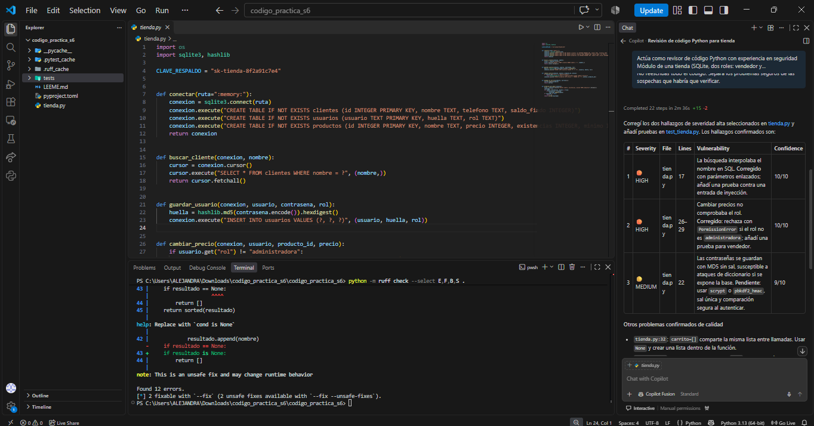
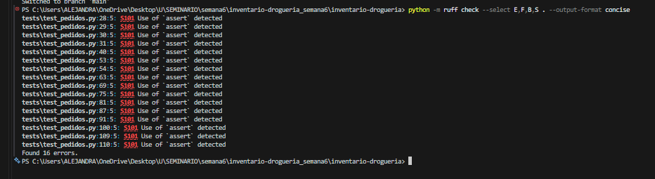
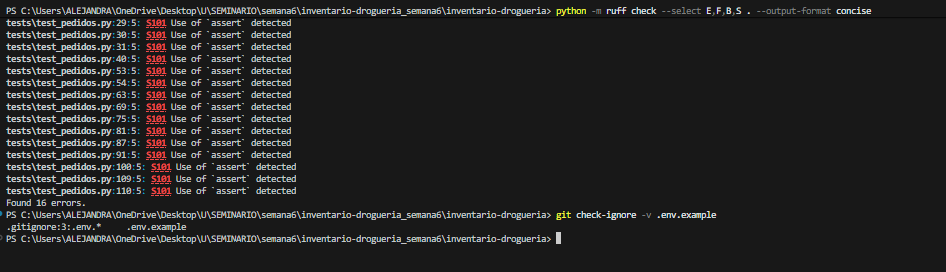
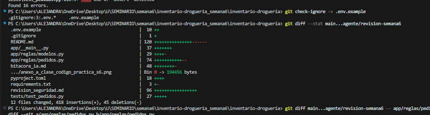
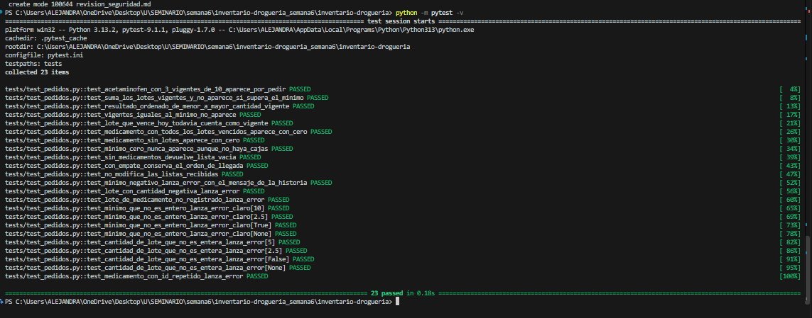
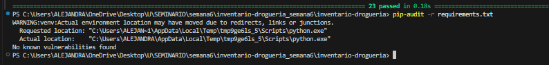
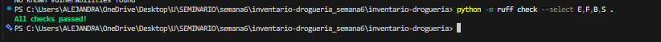
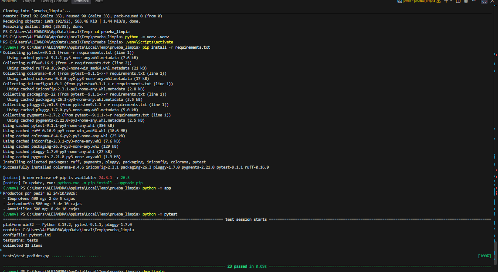
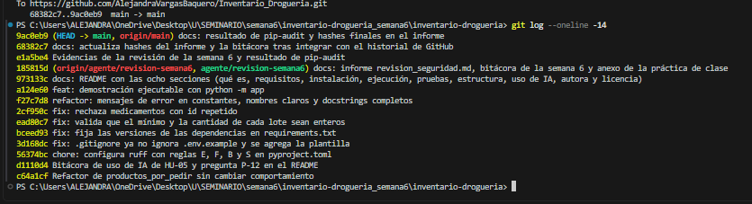

# Informe de revisión de código y seguridad

Proyecto: Sistema de inventario para una droguería de barrio, con control de lotes y fechas de vencimiento
Estudiante: Alejandra Vargas Baquero
Fecha: 2026-11-14
Commit revisado: `c89a877` (rama `main`, entrega de la semana 5)
Correcciones: rama `agente/revision-semana6`, integrada a `main` después de revisar el diff

## 1. Herramientas y criterios

- **Linter:** ruff 0.16.9 con las reglas E, F, B y S. Configuración en `pyproject.toml`. Antes no había configuración (H-05).
- **Auditoría de dependencias:** pip-audit sobre `requirements.txt`. Resultado: **[COMPLETAR con la última línea de la captura C05]**.
- **Lista de revisión:** la de la semana 6: corrección (historia y casos límite), diseño (ADR-001), legibilidad, pruebas (normales, límite, error y abuso) y seguridad (datos, claves, permisos y dependencias).
- **Revisión con IA:** Claude (chat), con el prompt de revisión de la semana (sección 3).
- **Capas:** pruebas automatizadas, linter, revisión con criterios, revisión de seguridad y revisión con IA. Ninguna capa encuentra todo: el linter no vio ningún problema de lógica y la IA no vio los dos problemas de configuración (sección 3).

### Puntos de seguridad revisados

| Punto | ¿Aplica? | Resultado |
|---|---|---|
| Inyección (consultas con parámetros) | Todavía no. Según el ADR-001, la capa de reglas no usa SQLite y aún no existe la capa de datos. `Select-String -Pattern "execute"` no encuentra nada. | Sin consultas. Se aplicó la idea de fondo: validar las entradas antes de usarlas (H-03 y H-04). Regla para la capa de datos en Pendientes. |
| Secretos (código, historial, .gitignore, .env.example) | Sí | No hay claves en el código ni en el historial (`git log -p` con búsqueda de `clave`, `password`, `secret`, `token` y `sk-`: solo aparece el comentario «Entorno y secretos» del `.gitignore`). `.env` está en `.gitignore`, pero `.env.*` también ignoraba `.env.example` (H-01). Corregido. |
| Contraseñas (scrypt, bcrypt o argon2 con sal) | Todavía no. Aún no hay usuarios ni inicio de sesión. | Sin hallazgos. Plan en Pendientes. |
| Control de acceso (rol verificado y prueba de abuso) | Todavía no. `productos_por_pedir` solo lee y no hay roles. | Las pruebas de abuso de esta capa son de datos mal formados (H-03 y H-04). Plan de roles en Pendientes. |
| Dependencias (existen, necesarias, versión fijada, pip-audit) | Sí | pytest y ruff existen en PyPI y se usan. `pytest>=8.0` no tenía versión fijada (H-02). Corregido. pip-audit: ver la sección 1. |

## 2. Tabla de hallazgos

Las líneas corresponden al commit revisado `c89a877`.

| Id | Archivo y línea | Problema | Categoría (OWASP 2021 o tipo) | Severidad | Corrección | Commit |
|---|---|---|---|---|---|---|
| H-01 | .gitignore:3 | `.env.*` también ignoraba `.env.example` (`git check-ignore -v .env.example` lo confirma), así que la plantilla nunca se habría subido | A05 Configuración insegura | Media | Excepción `!.env.example` y plantilla sin valores reales | `d20d2ba` |
| H-02 | requirements.txt:1 | `pytest>=8.0` sin versión fijada: una instalación futura puede traer otra versión | A06 Componentes vulnerables y desactualizados | Media | `pytest==9.1.1` y `ruff==0.16.9` | `e95a8bf` |
| H-03 | app/reglas/pedidos.py:42 y 52 | No se valida el tipo del mínimo ni de la cantidad: `"10"` lanza un `TypeError` sin mensaje para el usuario, y `True` o `2.5` se aceptan en silencio («0 de True cajas») | A04 Diseño inseguro, CWE-20 Validación de entradas | Media | `_es_entero` y `ValueError` con mensaje claro; 8 pruebas de abuso parametrizadas | `12426f4` |
| H-04 | app/reglas/pedidos.py:22 y 26 | Dos medicamentos con el mismo id salen dos veces en la lista y sus lotes cuentan para ambos | CWE-20 Integridad de datos | Media | `ValueError` «El medicamento con id N está repetido» y una prueba nueva | `d69f877` |
| H-05 | (no existía) pyproject.toml | Linter sin configurar en el proyecto | Configuración y calidad | Baja | `[tool.ruff.lint]` con E, F, B y S | `8fa6ac0` |
| H-06 | app/reglas/pedidos.py:40–62 | Mensajes de los lotes escritos dentro del código, `_validar_minimos` ya no describía lo que hace y los docstrings no decían qué reciben, qué devuelven ni qué errores lanzan | Mantenibilidad | Baja | Constantes de mensajes, `_validar_medicamentos` y docstrings completos | `2298b6a` |
| H-07 | README.md | Faltaban secciones (requisitos, instalación, ejecución, autora y licencia) y no había forma de ejecutar el proyecto | Documentación | Baja | README con las 8 secciones y `python -m app` | `b71e6b4`, `c065254` |

**Severidad:** alta (permite acceder o cambiar datos sin permiso, o expone secretos), media (error probable o riesgo con condiciones), baja (estilo o mantenibilidad).

Todas las pruebas pasan: de 14 se pasó a 23 (`python -m pytest -v`, captura C04). Ninguna prueba existente se modificó: `git diff c89a877 -- tests` solo muestra líneas agregadas.

### Avisos del linter no corregidos

| Regla | Archivo y línea | Por qué se mantiene |
|---|---|---|
| S101 (16 avisos) | tests/test_pedidos.py | `assert` es la forma normal de comprobar en pytest, y las pruebas no se ejecutan con `python -O`. Se ignora solo en `tests/` (`per-file-ignores`), no en `app/`. |

## 3. Revisión con IA

**Prompt usado:** «Actúa como revisor de código Python con experiencia en seguridad. Módulo: capa de reglas del inventario de una droguería (Python 3.13, solo librería estándar; Flask y SQLite llegan en otras capas según el ADR-001). Criterios: corrección y casos límite, diseño, legibilidad, pruebas y seguridad (inyección, secretos, contraseñas, control de acceso, validación de entradas). Formato: tabla con archivo, línea, problema, severidad y confianza. No reescribas todo el código: separa los problemas seguros de las sospechas que habría que verificar.» Le pasé `pedidos.py`, `modelos.py` y `test_pedidos.py` (bitácora, entrada 8).

| Hallazgo de la IA | ¿Real o falso positivo? | Cómo lo verifiqué |
|---|---|---|
| (Seguro) pedidos.py:42 y 52: no valida el tipo del mínimo ni de la cantidad | **Real** (H-03) | Llamé a la función con `"10"` (`TypeError`) y con `True` (devolvió «0 de True cajas»). |
| (Seguro) pedidos.py:22: ids repetidos producen filas duplicadas | **Real** (H-04) | Dos `Medicamento` con id 1: salieron los dos en la lista. |
| (Sospecha) pedidos.py:58: comparar un `datetime` con `date` lanza `TypeError` | **Real, fuera de alcance** | Lo comprobé. Hoy las fechas las crea el código como `date`; queda en Pendientes para la capa de datos. |
| (Sospecha) pedidos.py:37: `sorted` podría no conservar el orden en empates | **Falso positivo** | `sorted` es estable según la documentación de Python, y `test_con_empate_conserva_el_orden_de_llegada` pasa. |
| (Sospecha) `nombre` sin escapar podría causar XSS | **Falso positivo en esta capa** | La capa de reglas no genera HTML. Queda en Pendientes para la capa web. |
| (Seguro) S101: `assert` en las pruebas | **Falso positivo** | Es pytest; ver «Avisos del linter no corregidos». |

**Lo que la IA no encontró:** los dos problemas que no estaban en los archivos .py. El `.gitignore` ignoraba `.env.example` (H-01); lo encontré al revisar el punto de secretos con `git check-ignore -v .env.example` (captura C02). Y `pytest>=8.0` no tenía versión fijada (H-02); lo encontré al revisar el punto de dependencias. La IA solo revisa lo que le pasas, así que la lista de verificación sigue haciendo falta.

## 4. Pendientes

| Pendiente | Por qué no se corrigió todavía | Plan |
|---|---|---|
| Validar que `fecha_vencimiento` sea `date` y no `datetime` ni texto | Las fechas aún no vienen de fuera; llegarán con la capa de datos | Convertir y validar al leer de SQLite, con una prueba |
| Inyección SQL | No existe la capa de datos | Solo consultas con `?`; prueba con `' OR 1=1 --` como nombre |
| Contraseñas | No hay usuarios todavía | `hashlib.scrypt` con sal de `os.urandom(16)` y `hmac.compare_digest` (librería estándar, ADR-001) |
| Control de acceso | No hay roles todavía | Verificar el rol en cada operación que cambie datos (por ejemplo, el mínimo), con una prueba de abuso del rol sin permiso |
| XSS en nombres de medicamentos | No existe la capa web | Mantener el escape automático de Jinja2 y no usar `\|safe` |
| P-12: ¿10 de 10 aparece por pedir? | Depende del cliente | Preguntar en la próxima reunión |

**Claves expuestas:** Ninguna. El repositorio nunca tuvo claves; se revisó el historial completo.

## Anexos

**Anexo A. Práctica de clase (código `codigo_practica_s6/tienda.py`).** Ejercicio guiado de la sesión de la semana 6, antes de revisar mi proyecto. Corrí `python -m ruff check --select E,F,B,S .` (12 avisos, 2 corregibles automáticamente, como `== None` en lugar de `is None`) y le pedí a Copilot una revisión con el mismo prompt. Copilot confirmó: consulta SQL armada con el nombre en la línea 17 (alta, corregida con parámetros y prueba de inyección), `cambiar_precio` sin verificar el rol (alta, corregida con `PermissionError` y prueba del vendedor), contraseñas con MD5 sin sal en la línea 22 (media, pendiente: scrypt o pbkdf2_hmac) y `carrito=[]` mutable en la línea 32. En el código también se ve `CLAVE_RESPALDO = "sk-tienda-…"` escrita en la línea 4: una clave en el código que habría que mover a una variable de entorno y cambiar. Esa práctica es la base de la lista que apliqué en las secciones 1 a 4.

**Anexo B. Evidencias de mi proyecto**

| Captura | Qué muestra |
|---|---|
|  | C01. ruff en el commit revisado: solo S101 en las pruebas |
|  | C02. `git check-ignore -v .env.example` en el commit revisado (H-01) |
|  | C03. Revisión del diff de la rama del agente antes de integrarla |
|  | C04. `python -m pytest -v`: 23 passed |
|  | C05. `pip-audit -r requirements.txt` |
|  | C06. ruff después de las correcciones: All checks passed! |
|  | C07. Instalación y `python -m app` en una carpeta limpia |
|  | C08. `git log --oneline`: un commit por corrección |
